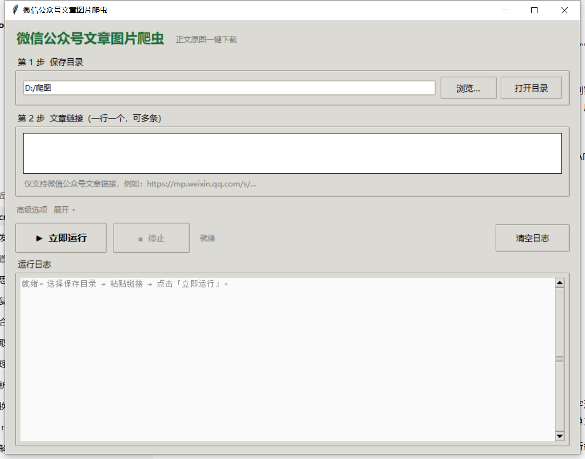

# 微信公众号原图下载器

<p align="center">
  
</p>

<p align="center">
  <b>零依赖 · 开箱即用 · 单文件桌面程序</b><br>
  粘贴微信公众号文章链接，一键批量下载正文原图到本地。
</p>

<p align="center">
  <a href="https://github.com/acejaiy/wechat-image-downloader/releases"></a>
  <a href="https://github.com/acejaiy/wechat-image-downloader/blob/main/LICENSE"></a>
  
</p>

---

## 为什么做这个

网上能搜到的公众号图片工具，大多需要你先装 Python、Playwright、浏览器内核或 Node.js，对只想「贴个链接存图」的普通用户门槛太高。

这个项目的目标是：**下载一个 exe，双击打开，贴链接，点运行**，就这么简单。

- 单个 exe 文件，无需安装 Python 或任何运行环境
- 原生桌面窗口，不起浏览器、不起本地网页服务
- 只依赖 Python 标准库 + Pillow，纯 HTTP 抓取，快且轻
- 特别处理了「图片消息类」文章 —— 这类文章的图内嵌在 JS 变量里，没有 `` 标签，用浏览器走 DOM 反而抓空

## 功能特性

- **批量下载**：一次粘贴多条链接，一行一个，自动排队处理
- **正文原图**：优先取服务器原图（去掉 webp / 懒加载压缩参数），不是缩略图
- **智能过滤**：自动跳过头像、二维码、装饰图、过小图片、黑图/纯色占位图
- **自动去重**：按图片内容 MD5 去重，重复运行不会累积副本
- **灵活保存**：可自定义保存目录和子文件夹，图片按序号命名
- **实时日志**：运行过程实时显示在窗口里，成功/跳过/失败一目了然
- **可中断**：长任务可随时点「停止」

## 快速开始（推荐）

1. 到 [Releases 页面](https://github.com/acejaiy/wechat-image-downloader/releases) 下载 `微信公众号文章图片爬虫.exe`
2. 双击运行（首次启动会解压几秒，属正常现象）
3. 在「保存目录」选择图片要存的位置（默认是桌面的 `爬图` 文件夹）
4. 把公众号文章链接粘贴到「文章链接」框，一行一个
5. 点击「▶ 立即运行」，等待完成提示

> 支持形如 `https://mp.weixin.qq.com/s/xxxxxx` 的文章链接。

## 从源码运行

如果你不想用 exe，也可以跑源码：

```bash
# 环境：Python 3.8+（已验证 3.14）
pip install pillow
python crawler_gui.py        # 图形界面
```

命令行模式（无需界面）：

```bash
python crawler_windows.py --url "https://mp.weixin.qq.com/s/xxxxxx" --out "D:/图片" --min-bytes 20000
```

参数说明：

| 参数 | 说明 |
| --- | --- |
| `--url` | 单篇文章链接（不填则用代码里 `LINKS` 列表） |
| `--out` | 保存目录（默认桌面 `爬图` 文件夹） |
| `--min-bytes` | 图片最小字节数，小于此值跳过（默认 20000） |

## 自己打包 exe

Windows 下双击 `build.bat`，会自动安装依赖并用 PyInstaller 生成单文件 exe，输出在 `dist/` 目录。

```bash
pip install -r requirements.txt
pyinstaller --noconfirm --clean --onefile --windowed \
  --name "微信公众号文章图片爬虫" --collect-all PIL \
  --icon=NONE crawler_gui.py
```

## 工作原理

微信目前主要有两类文章：

- **图片消息 / 图集类**：图片内嵌在页面 JS 变量 `picture_page_info_list` 的 `cdn_url` 字段里，页面没有 `` 标签，也没有 `#js_content` 容器。浏览器 DOM 抓取会失败，因此本项目对这类文章直接抓 HTML + 正则提取原图。
- **普通图文类**：正文在 `#js_content` 里，图片在 `data-src` / `data-original` 属性中，同样走 HTML 解析。

提取到图片 URL 后，带上 `Referer: https://mp.weixin.qq.com/` 逐张下载以绕过图床防盗链，再做体积、像素、去重过滤后落盘。整个过程不启动浏览器。

## 目录结构

```
wechat-image-downloader/
├── crawler_gui.py          # 图形界面（GUI 外壳）
├── crawler_windows.py      # 爬虫核心逻辑
├── build.bat               # Windows 一键打包脚本
├── requirements.txt        # 依赖
├── LICENSE                 # MIT 许可证
└── docs/
    └── screenshot.png      # 界面截图
```

## 常见问题

**Q：双击 exe 没反应 / 启动慢？**
A：单文件 exe 首次启动需要把内容解压到临时目录，约几秒钟，请稍等。若杀毒软件误报，可加入白名单。

**Q：抓取失败或图片数为 0？**
A：确认链接是有效的公众号文章链接且能正常在浏览器打开；部分临时分享链接会过期。若文章被反爬拦截，日志会提示 HTML 内容异常。

**Q：图片顺序是按文章顺序吗？**
A：是的，按正文中出现的顺序从 `001.jpg` 开始编号。

**Q：支持抖音、小红书吗？**
A：不支持，本项目专注微信公众号文章。

## 合规与免责声明

- 本项目仅用于**个人学习和研究**，请勿用于任何商业用途或大规模抓取。
- 使用时请遵守微信公众平台的相关服务条款和 robots 协议，尊重原作者版权。
- 请勿高频、批量抓取他人内容，避免对相关服务造成影响；由此产生的任何后果由使用者自行承担。
- 作者不对使用本软件造成的任何损失或法律责任负责。

## 许可证

[MIT](LICENSE) © 2026 wechat-image-downloader contributors
